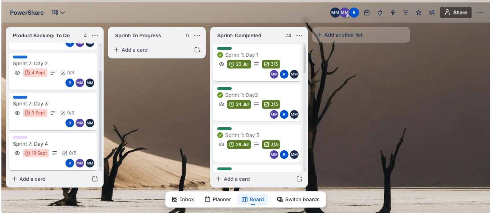
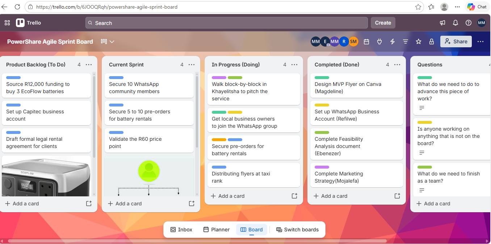

# 👩🏽‍💻 Magdeline Malahlela

**Aspiring Software Engineer | Final-Year ICT Applications Development Student**

📍 Cape Town  
📞 060 461 9111  
📧 malahlelamagdeline@gmail.com  

🔗 [LinkedIn](https://www.linkedin.com/in/magdeline-malahlela-032781245)  
💻 [GitHub](https://github.com/Magdeline29)  
🌐 [Portfolio Website](https://magdeline29.github.io)  

---

## 🎯 Career Objective

A highly motivated and driven final-year ICT Applications Development student at Cape Peninsula University of Technology, seeking a Work Integrated Learning (WIL) opportunity in Software Engineering.

I am passionate about building efficient, user-focused systems and continuously improving my technical skills. I have hands-on experience in both frontend and backend development, with a strong foundation in Java, databases, and modern web technologies.  

I am eager to contribute to a dynamic team, gain industry experience, and further develop my problem-solving and software development skills in a professional environment.

---

## 🎓 Education

**Cape Peninsula University of Technology (CPUT)**  
Diploma in ICT: Applications Development  
*Final Year Student (Current)*  

---

## 💻 Projects

### 🟣 Portfolio Website
A personal portfolio website designed and developed to showcase my skills, projects, and professional profile.

**Technologies Used:**
- JavaScript  
- React  
- CSS  

**Key Highlights:**
- Responsive and user-friendly interface  
- Showcases projects and skills  
- Focus on clean design and usability  

---

### 🟣 Smart Menu Application
A student ordering system designed to reduce queues and improve efficiency in campus food services.

**Technologies Used:**
- Java (Swing for GUI)  
- SQL (Database integration)  

**Key Features:**
- Student login and registration  
- View menu and pricing  
- Add items to cart  
- Checkout system  
- Order tracking  

**My Role:**
Backend Developer & Secretary (documentation, coordination, and version control)

---

### 🟣 Student Internship Management System
A system designed to manage internship applications for students and administrators.

**Technologies Used:**
- Java  
- MySQL  

**Key Features:**
- Admin entity and repository implementation  
- CRUD operations  
- Use of design patterns (Singleton)  
- Backend-focused architecture  

---

## 🛠️ Technical Skills

| Category      | Skills |
|--------------|--------|
| **Frontend** | React, UX/UI Design |
| **Backend**  | Java, Python, Node.js |
| **Database** | MySQL |
| **Tools**    | Git & GitHub, Figma, Microsoft Azure, VS Code |
| **Other**    | Problem Solving, Agile Methodologies |

---

## 🎥 Mock Interview

Watch my mock interview video below, demonstrating my communication skills, technical knowledge, and readiness for the workplace:

▶️ [Watch Mock Interview](https://drive.google.com/file/d/1266u2mltiGit0Nk_kwknaJLJcL5HcfoW/view?usp=sharing)

---

## 📝 Reflection: Coding in Markdown

**Situation:**  
I was required to create a digital portfolio using Markdown and GitHub for my Project presentation 3 module at Cape peninsula University Of Technology.

**Task:**  
My goal was to design a professional and well-structured portfolio that clearly presents my skills, projects, and work readiness.

**Action:**  
I learned and applied GitHub Flavoured Markdown to structure my content using headings, lists, links, and formatting. I focused on making the portfolio clean, readable, and visually appealing while maintaining professionalism.

**Result:**  
I successfully created a well-organized portfolio that showcases my technical skills and projects. This experience improved my documentation skills and taught me how developers present their work in real-world environments.

---

## 🎤 Reflection: Mock Interview Experience 

**Situation:**  
As part of my work readiness training, I participated in a mock interview.

**Task:**  
I needed to present myself professionally, answer technical and behavioral questions, and demonstrate confidence.

**Action:**  
I prepared by reviewing common interview questions, practicing my responses, and improving my communication skills. During the interview, I focused on being clear, confident, and structured in my answers.

**Result:**  
The experience helped me identify areas for improvement, especially in confidence and articulation. It also boosted my readiness for real-world interviews and improved my ability to present myself professionally.

---

## 🌐 Reflection: GitHub Pages 

**Situation:**  
I was required to publish my digital portfolio using GitHub Pages.

**Task:**  
My objective was to deploy my Markdown portfolio as a live website accessible online.

**Action:**  
I created a GitHub repository, uploaded my Markdown files, and configured GitHub Pages to host my portfolio. I ensured that all links and content were working correctly.

**Result:**  
I successfully published my portfolio online. This experience helped me understand version control, deployment, and how developers showcase their work professionally.

---

# 🚀 Agile Project Portfolio: PowerShare

For the Agile section of this portfolio I use **PowerShare (Power-Share: Load Shedding Business)**, a group project that proposes an affordable, pay-as-you-go portable battery rental service for micro-entrepreneurs (barbers, tailors, spaza shops and internet cafés) in Khayelitsha and Mitchells Plain who lose income during load shedding.

**My role:** Designer (visuals, flyers and UI concepts)  
**Team:** Ephraim Ebenezer Kouakou (Team Leader & Presenter), Mojalefa Mabotja (Researcher), Refilwe Mabena (Writer/Editor) and myself  
**Project boards:** [PowerShare Trello (sprint stories)](https://trello.com/b/hzrrm66i/powershare) | [PowerShare Agile Sprint Board](https://trello.com/b/6JOOQRqh/powershare-agile-sprint-board)

| Section | Evidence | Reflection |
|---|---|---|
| Agile Team Charter | [Charter](#-agile-team-charter) | [Reflection](#reflection-agile-team-charter) |
| User Stories and Tasks | [Stories](#-user-stories-and-tasks) | [Reflection](#reflection-user-stories-and-tasks) |
| Product Backlog | [Backlog](#-product-backlog) | [Reflection](#reflection-product-backlog) |
| Sprint Backlog | [Sprint](#-sprint-backlog) | [Reflection](#reflection-sprint-backlog) |
| Agile Logbook | [Logbook](#-agile-logbook) | [Reflection](#reflection-agile-logbook) |

---

## 🤝 Agile Team Charter

### Evidence

📄 [Download the PowerShare Agile Team Charter (PDF)](evidence/powershare/source-documents/PowerShare-Agile-Team-Charter.pdf)  
📝 [Read the charter summary](evidence/powershare/agile-team-charter.md)

The four-page charter documents:

- **Purpose and vision:** an affordable portable-power rental service that helps township entrepreneurs keep trading during outages and reduces their lost income.
- **Roles:**

| Team member | Role | Responsibilities |
|---|---|---|
| Ephraim Ebenezer Kouakou | Team Leader & Presenter | Coordinates the team, manages deadlines, leads presentations |
| **Magdeline Malahlela** | **Designer** | Designs visuals, flyers and UI concepts |
| Mojalefa Mabotja | Researcher | Market research and data gathering |
| Refilwe Mabena | Writer/Editor | Writes, edits and compiles documentation |

- **Core values:** collaboration, respect, accountability and transparency.
- **Working agreements:** WhatsApp for daily updates, weekly in-person campus meetings, shared Google Docs/Word files; meet deadlines, communicate early, respect meeting times, contribute actively.
- **Conflict resolution:** discuss openly, team leader mediates, escalate to the lecturer if unresolved.
- **SMART goal and milestones:** validate the MVP within one to two weeks of testing, with at least 20 WhatsApp group members and 5 to 10 pre-orders, moving from idea and research through marketing, MVP design, customer outreach and feedback to final submission.

### Reflection: Agile Team Charter

**Situation:**  
At the start of PowerShare our team of four needed a shared agreement on how we would work together, because we each had a different role and were coordinating between campus meetings and WhatsApp.

**Task:**  
As the team's Designer, I needed to understand what the charter expected of me (visuals, flyers and UI concepts) and how my work fitted with the leader, researcher and writer.

**Action:**  
I took part in agreeing our roles and accepted the Designer role, which meant owning visuals, flyers and UI concepts. I followed the communication plan by posting my design drafts in the team WhatsApp group so that Ephraim, Mojalefa and Refilwe could comment before I finalised them, and I attended the weekly campus meetings to hear what the research and writing needed from me.

**Result:**  
Clear roles meant I always knew what was mine: when the team needed a flyer for customer outreach, nobody had to ask who would make it. The shared WhatsApp group also let us redistribute tasks quickly when a member was unavailable in July. One thing I would improve is reviewing the charter at the end of each sprint, because we agreed on values like accountability and transparency at the start but never checked how well we were living up to them.

---

## 📖 User Stories and Tasks

### Evidence

📝 [Read the full user stories and tasks notes](evidence/powershare/user-stories-and-tasks.md)

Our Trello board breaks each user story into three checklist tasks. Example from **Sprint 1, Day 1**:

> *As a new customer, I want to create an account so that I can access the PowerShare battery rental services.*

| Task | Status on board |
|---|---|
| Design registration screen UI | ✅ Complete |
| Implement registration form | ✅ Complete |
| Validate required user information | ✅ Complete |

Example from **Sprint 2, Day 1** (battery catalogue): tasks were to design the catalogue, display battery cards and add battery images. The image task was still incomplete on the board.

The stories cover customer registration, login, battery discovery, booking, payment, rental management, profile and support. **Sprint 7** adds administrator stories (inventory and bookings, customers and reports, and testing of management features); these are still at 0/3 tasks complete.

> A completed checklist shows board status. It is not independent proof that a feature was fully built and tested.

### Reflection: User Stories and Tasks

**Situation:**  
PowerShare's work was organised as user stories written from the customer's or administrator's point of view, each split into three small tasks on Trello.

**Task:**  
I needed to understand each story well enough to design the screens that matched it. For example, the registration story needed a registration screen design.

**Action:**  
I worked on the design side of the registration story ("As a new customer, I want to create an account..."). Because the goal was to let a customer start using the rental service, I designed the registration screen to be short, asking only for the required details, so a small-business owner on a phone could sign up quickly. My "Design registration screen UI" task came first so that the "Implement registration form" task could follow the design.

**Result:**  
Splitting stories into small tasks made progress visible, with 3/3 checklists on early sprints, but it also showed gaps, such as the unfinished battery images task. I learned that a story is only useful if its tasks are small enough to finish and check off. Next time I would add clear acceptance criteria to each story, for example "the registration form rejects empty required fields", so that "done" means the same thing to everyone, and I would make sure a task like "Add battery images" always has a named owner.

---

## 📋 Product Backlog

### Evidence

📝 [Read the product backlog notes](evidence/powershare/product-backlog.md)

The product backlog is held on Trello. It lists everything the project still needs, mixing product features (registration, booking and cancellation, booking history, collection and return, rental charges, payment, receipts, rental policy, inventory tracking, monthly reporting) with business set-up work.

The **PowerShare Agile Sprint Board** shows the backlog column alongside the current sprint:

| Product Backlog (To Do) | Current Sprint |
|---|---|
| Source R12,000 funding to buy 3 EcoFlow batteries | Secure 10 WhatsApp community members |
| Set up Capitec business account | Secure 5 to 10 pre-orders for battery rentals |
| Draft formal legal rental agreement for clients | Validate the R60 price point |

### Reflection: Product Backlog

**Situation:**  
The team had far more to do than could fit in one sprint, covering both the app and the business itself (funding, a business account, a legal agreement).

**Task:**  
The backlog had to be ordered so that the work needed to prove the idea came first.

**Action:**  
Looking at the board, validation work (WhatsApp members, pre-orders, the R60 price point) sits in the current sprint, while funding, banking and legal items wait in the backlog. In our discussions I argued that customer validation should come first, because there was no point spending R12,000 on EcoFlow batteries before we knew people would pre-order and accept the price. I backed this up with the survey results in our logbook, which showed interest in an affordable rental.

**Result:**  
A real priority decision was putting "Validate the R60 price point" in the current sprint and leaving "Source R12,000 funding" in the backlog: validating demand cost almost nothing, while funding depended on its outcome. Next time I would rank items with a simple value-versus-effort score and record it on each Trello card, so the order is explained and not just assumed.

---

## 🏃 Sprint Backlog

### Evidence

📝 [Read the sprint backlog notes](evidence/powershare/sprint-backlog.md)

- **Sprints 1 to 6** are in the **Sprint: Completed** list (24 cards), covering registration, authentication, the battery catalogue and search, booking, payment and receipts, rental management, profile and support. Almost all checklist items are ticked; "Add battery images" in Sprint 2, Day 1 stayed incomplete.
- **Sprint 7 (admin work)** remains in the backlog, with due dates of 4, 9 and 10 September and 0/3 tasks complete on each card:

| Card | User story | Tasks (all incomplete) |
|---|---|---|
| Sprint 7: Day 2 | Manage battery inventory and bookings | Inventory page, booking page, battery status display |
| Sprint 7: Day 3 | Manage customers and reports | Customer page, reports dashboard, business analytics |
| Sprint 7: Day 4 | Test and validate management features | Test dashboard navigation, verify features, resolve issues |

On the Agile Sprint Board, the sprint also shows work moving across columns. **Design MVP Flyer on Canva (Magdeline)** is in *Completed*, alongside the Feasibility Analysis (Ebenezer), WhatsApp Business Account (Refilwe) and Marketing Strategy (Mojalefa). Block-by-block pitching in Khayelitsha and flyer distribution at the taxi rank are *In Progress*.

### Reflection: Sprint Backlog

**Situation:**  
Work was planned in daily sprint cards ("Sprint 1: Day 1" and so on) with three tasks each, plus a separate sprint board for the business-validation activities.

**Task:**  
My responsibility in the sprint was design, and I completed the MVP flyer on Canva as recorded on the board.

**Action:**  
I designed the MVP flyer in Canva with a clear message about renting batteries during load shedding, and I kept the layout simple and readable for people who would only look at it for a few seconds, for example at the taxi rank. I shared the draft with the team for feedback, made corrections, and moved the card to Completed once the team had approved it.

**Result:**  
Sprints 1 to 6 were completed on the board, but Sprint 7 (admin features) was not delivered, so I treat it as outstanding work, not a finished feature. Sprint 7 stayed unfinished because our time went into the customer-facing features and business validation first, and the admin stories were left to the end with too little time. Next time I would plan sprints with realistic estimates, keep the most valuable stories early, and check the board at the end of each sprint day so that anything at risk is moved or rescheduled in time.

---

## 📓 Agile Logbook

### Evidence

📄 [Download the PowerShare Agile Project Logbook (DOCX)](evidence/powershare/source-documents/PowerShare-Agile-Project-Logbook.docx)  
📝 [Read the logbook summary](evidence/powershare/agile-logbook.md)

The logbook records a taskboard (Product Backlog, In Progress, Completed) and dated progress entries:

| Date | Focus | Planned next / challenge |
|---|---|---|
| 14 July 2026 | Refined the business idea and the problem faced by micro-entrepreneurs in Khayelitsha and Mitchells Plain; reviewed market-validation survey information | Analyse survey findings; challenge was linking findings clearly to the problem |
| 15 July 2026 | Analysed the survey: income losses during outages, limited backup power, interest in affordable rental | Finalise the operational workflow (central hub charging, delivery, collection, recharging); present the R50 to R80 daily price consistently |
| 16 July 2026 | Finalised the value proposition and target customers (barbers, tailors, spaza shops, internet cafés); one member unavailable, so tasks were redistributed | Complete and review the presentation content |
| 17 July 2026 | Final review of the business model and presentation for consistency; reviewed the design and community-benefit message | Prepare final deliverables and corrections |

No major blockers were reported, but the team noted the difficulty of organising research findings and keeping the business model, survey results and solution consistent.

### Reflection: Agile Logbook

**Situation:**  
Over 14 to 17 July 2026 the team kept dated logbook entries while finishing the business model and presentation. During that time one member was unavailable and tasks had to be redistributed.

**Task:**  
Keep the work consistent across four people, and keep the presentation design clear and aligned with the survey results.

**Action:**  
On these dates I worked on the design of the presentation and the flyer. When one team member was unavailable on 16 July, I took over part of the presentation design tasks so the content could still be reviewed on time. On 17 July I checked my slides against the survey results and the R50 to R80 daily price to make sure the numbers matched what the rest of the team had written.

**Result:**  
Writing things down daily showed where our information could drift apart, such as the price and survey findings, and the redistribution of tasks kept the deliverables on track. I learned that short daily updates make it easy to catch inconsistencies early, and that clear communication matters most when someone is absent. Next time I would record the name of the person who completed each task, because the logbook describes team activity but does not always show who did what, which makes individual contribution harder to prove.

---

## 🔗 Connecting It All

The charter set our roles and working agreements, and as Designer I knew my place in the team. Those roles shaped the user stories, which were broken into three tasks each on Trello. The product backlog held everything still to do, the sprint backlog pulled the next pieces into focus, and the logbook recorded how the work really went, including a missing team member and the need to keep information consistent. Working on PowerShare taught me that Agile is a chain of connected decisions, not a set of separate documents. It prepares me for a WIL placement because I can now work from a backlog, break stories into tasks, update a board daily, adapt when a team member is away and explain my own contribution clearly.

---
## ✨ About Me

I am a passionate and goal-driven IT student with a strong interest in software engineering, data, and cloud technologies. I enjoy solving problems, building systems, and continuously learning new technologies.

I am currently seeking an opportunity where I can apply my knowledge, grow professionally, and contribute meaningfully to real-world projects.
