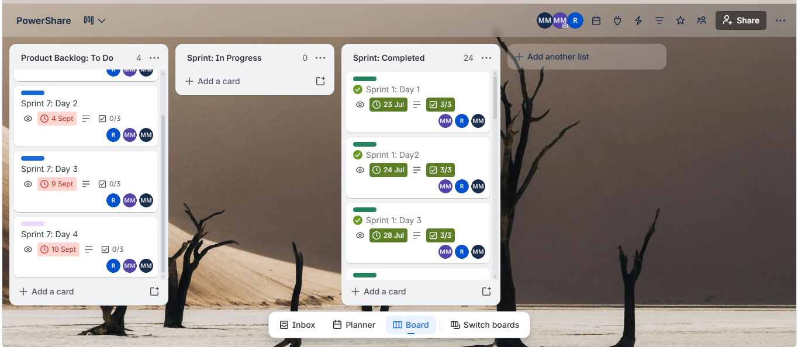
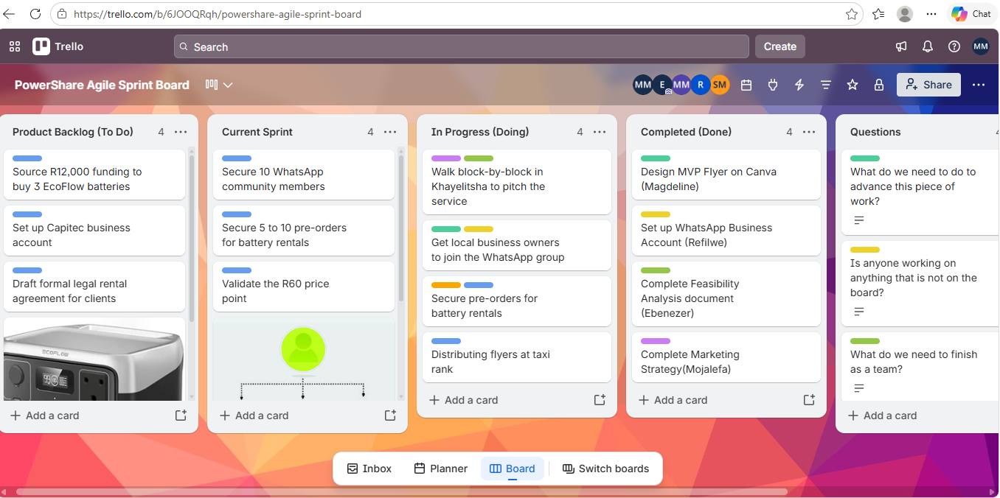

# Sprint Backlog — PowerShare

## Evidence available
The Trello export contains Sprint 1–6 story cards in a list labelled **Sprint: Completed**. Their checklists record work on customer registration, authentication, the battery catalogue and search, battery details, booking, payment and receipts, rental management, customer profile and support.

Most checklist items across those cards are marked complete in the export. The Sprint 2 Day 1 “Add battery images” item remains incomplete. Sprint 7 admin stories remain in **Product Backlog: To Do**, with checklist tasks for the admin dashboard, inventory and booking management, customer management, reports, navigation tests and issue resolution marked incomplete.

A card being in a list labelled “Sprint: Completed” or being archived is not by itself proof that every feature was implemented. The checklist state is the specific evidence available from the export.

- [Open PowerShare Trello](https://trello.com/b/hzrrm66i/powershare)

## Add before submission
- Screenshots showing sprint cards, task checklists and status.
- The actual sprint goal(s), if recorded by your team.
- A brief explanation of how work was selected for each sprint and how completion was reviewed.

## Reflection prompts — replace with your own experience
- What was my responsibility in a specific sprint?
- Did the team achieve its sprint goal? Use real evidence and explain any unfinished work.
- What would I change about sprint planning, estimation or tracking next time?

## Sprint 7 — administrative work still in the backlog
The user supplied the following Sprint 7 card contents. Each of these cards is recorded at 0% with all three subtasks incomplete:

### Day 2 — Manage battery inventory and bookings
**User story:** “As an administrator, I want to manage battery inventory and bookings so that operations remain organized.”
- Create inventory management page — incomplete
- Create booking management page — incomplete
- Display battery status — incomplete

### Day 3 — Manage customers and reports
**User story:** “As an administrator, I want to manage customers and reports so that I can make informed business decisions.”
- Create customer management page — incomplete
- Create reports dashboard — incomplete
- Display business analytics — incomplete

### Day 4 — Test and validate management features
**User story:** “As an administrator, I want all management features to work correctly so that I can operate the system efficiently.”
- Test admin dashboard navigation — incomplete
- Verify management features — incomplete
- Resolve dashboard issues — incomplete

The Trello screenshot supplied by the student shows the sprint board and its columns. The detailed Day 2–4 story text above was supplied in the conversation. These tasks are presented as planned/incomplete work, not as delivered functionality.

